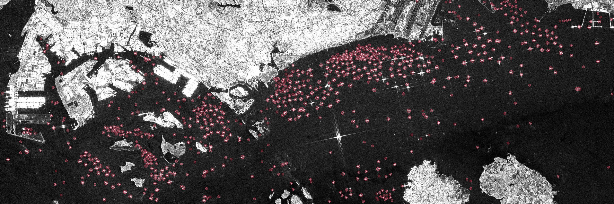
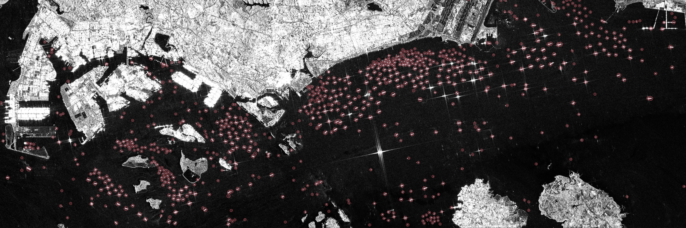

**⚠️ Notice: AI-Generated Content**

**This repository contains code generated by Artificial Intelligence (AI) tools. While this code has been tested, it may contain undetected security vulnerabilities, logical flaws, or outdated patterns. Users are strongly advised to review, audit, and test all code thoroughly in a safe environment before deploying it to production.**

**For more information: [info@projectharrison.org](mailto:info@projectharrison.org)**

# Sentinel-1 Ship Detection

`sentinel1_ship_detection` detects vessels in Sentinel-1 synthetic aperture radar (SAR) imagery. Given a bounding box, the pipeline downloads the most recent Sentinel-1 pass from the Copernicus Data Space Ecosystem, runs a pretrained vessel detector over the scene, and writes each detected ship to CSV and GeoJSON with estimated length, width, heading and speed.



*Singapore Strait, Sentinel-1D, 9 Oct 2026, 11:24 UTC. 764 vessels detected in about 2 minutes on a 4-core laptop CPU. Ring size scales with vessel length.*

## How the pipeline works

The download step requests the newest Sentinel-1 IW scene over the bounding box through the Sentinel Hub Process API, on the 9.55 m Web Mercator grid the detector was trained on.

The detector expects raw amplitude rather than calibrated backscatter, so the image is converted with `DN = 237 × √β⁰` and clipped to 0–255.

A Faster R-CNN then scans the scene in 2048 px windows. Detections scoring below 0.5 are discarded, detections within ~190 m of each other are merged, and detections on land are removed using a land mask derived from the image.

Finally, a ResNet-50 attribute model estimates each vessel's length, width, heading and speed.

An interactive walkthrough of each step on the Singapore scene is in [`examples/singapore-2026-10-09/explainer.html`](examples/singapore-2026-10-09/explainer.html).

## Setup

Requirements: Python 3.11 and a free [Copernicus Data Space](https://dataspace.copernicus.eu/) account.

```bash
git clone https://github.com/ShippingIntel/sentinel1-ship-detection.git
cd sentinel1-ship-detection
python3 -m venv .venv && source .venv/bin/activate
pip install --only-binary=:all: -r requirements.txt
scripts/setup_models.sh          # downloads the pretrained models (~210 MB)
cp .env.example .env             # add your Copernicus OAuth client ID and secret
```

To create OAuth credentials, open the [Sentinel Hub dashboard](https://shapps.dataspace.copernicus.eu/dashboard/) and go to User settings → OAuth clients.

## Usage

```bash
python -m sentinel1_ship_detection --bbox 103.60 1.15 104.20 1.35 --name singapore
```

| Option | Default | Description |
|---|---|---|
| `--bbox MIN_LON MIN_LAT MAX_LON MAX_LAT` | required | Area to search |
| `--date YYYY-MM-DD` | today | Latest acquisition date to accept |
| `--lookback-days N` | 12 | How many days back to search for a scene |
| `--name NAME` | `area` | Output folder under `output/` |
| `--conf X` | 0.5 | Detection confidence threshold |
| `--keep-land` | off | Keep detections on land and along the shoreline |

The download and detection stages can also be run separately:

```bash
python -m sentinel1_ship_detection.download --bbox 103.60 1.15 104.20 1.35 --out output/singapore
python -m sentinel1_ship_detection.detect output/singapore/<scene>.tif
```

### Outputs

| File | Contents |
|---|---|
| `<scene>.tif` | Radar image. Band 1 is VH, band 2 is VV. EPSG:3857, 9.55 m/px |
| `<scene>_detections.csv` | One row per vessel: lat, lon, score, length, width, heading, speed |
| `<scene>_detections.geojson` | The same detections as map points, for QGIS, geojson.io or Google Earth |
| `<scene>_preview.png` | The radar image with each detected vessel circled |



*Contains modified Copernicus Sentinel data (2026), processed by the Copernicus Data Space Ecosystem. Vessel detections by the Allen Institute for AI [vessel-detection-sentinels](https://github.com/allenai/vessel-detection-sentinels) model (Apache-2.0).*

Sample outputs from the Singapore run are in [`examples/singapore-2026-10-09/`](examples/singapore-2026-10-09/).

## Accuracy and limitations

The detections have not yet been validated against AIS. So far, results have been checked visually on a single scene: of 665 very bright targets on open water, 591 had a detection within 140 m, and most of the misses were sidelobe glare or piers.

The model's authors use a confidence threshold of 0.9, but on the Singapore Sentinel-1 scene the brightest ships score between 0.5 and 0.9, so the default `--conf` value in sentinel1_ship_detection is 0.5.

The land mask also removes ships at berth. Pass `--keep-land` to retain ships at berth.

Length and speed estimates look plausible. Heading estimates appear biased and should be treated as rough.

The detector supports using one or two earlier passes to suppress fixed structures such as beacons, but sentinel1_ship_detection currently uses only the newest scene.

At 10 m resolution, vessels shorter than about 40 m are rarely detected.

## Project layout

```
sentinel1_ship_detection/
  __main__.py      download and detection in one command
  download.py      Sentinel-1 search and download (Copernicus Sentinel Hub APIs)
  detect.py        detection, land masking, attribute prediction, outputs
scripts/
  setup_models.sh  downloads the pretrained models into third_party/
examples/          sample outputs and the interactive explainer
```

## Attribution

The detection model, the attribute model, and the inference code that sentinel1_ship_detection uses to run both models come from the Allen Institute for AI.

- **Models:** Sentinel-1 vessel detector (Faster R-CNN, checkpoint `frcnn_cmp2/3dff445`) and vessel attribute model (ResNet-50, checkpoint `attr/c34aa37`)
- **Authors:** Patrick Beukema, Favyen Bastani, Piper Wolters, Henry Herzog, Joe Ferdinando
- **Institution:** Allen Institute for AI (Ai2), Seattle
- **Paper:** *Satellite Imagery and AI: A New Era in Ocean Conservation, from Research to Deployment and Impact.* NeurIPS 2023 workshop, December 2023. [arXiv:2312.03207](https://arxiv.org/abs/2312.03207). A revised version from May 2025 adds a sixth author, Yawen Zheng.
- **Code and weights:** [allenai/vessel-detection-sentinels](https://github.com/allenai/vessel-detection-sentinels), Apache-2.0 license
- **Training data:** Sentinel-1 radar images from 2020–2022, hand-labeled by experts
- **Used in:** Ai2's Skylight maritime monitoring platform

Imagery: contains modified Copernicus Sentinel data (2026), processed by the Copernicus Data Space Ecosystem.
